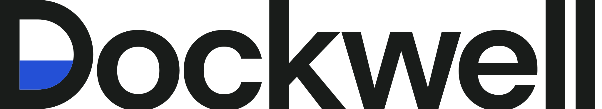
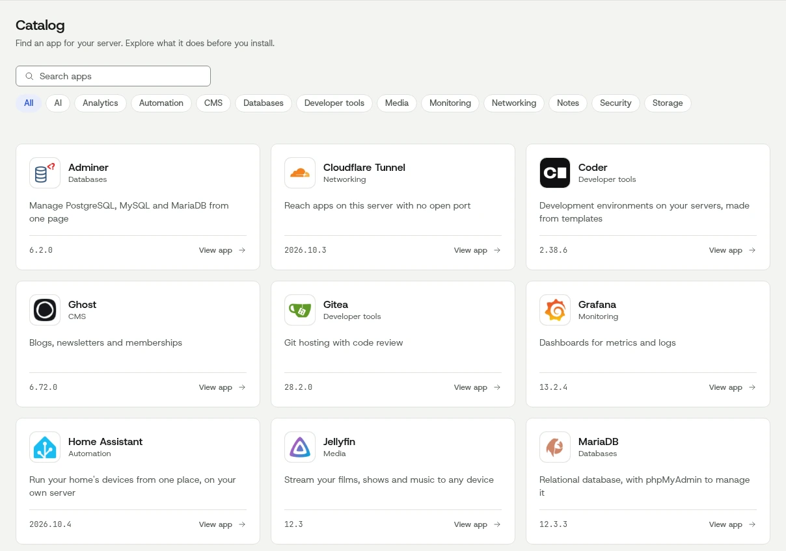

<p align="center">
  <picture>
    <source media="(prefers-color-scheme: dark)" srcset="design/system/brand/dockwell-logotype-dark.svg">
    
  </picture>
</p>

<p align="center">An open-source control panel for your own servers, from one VPS to many.<br>Apps, websites, databases, domains and deploys in one place.</p>

<p align="center">
  <a href="#install">Install</a> ·
  <a href="#what-you-can-do">What you can do</a> ·
  <a href="#how-it-works">How it works</a> ·
  <a href="#documentation">Documentation</a> ·
  <a href="#contributing">Contributing</a>
</p>

> **Status: early.** v0.3.0 is the first release you can install and use day to day. It isn't ready for production yet: expect rough edges, and keep backups of anything that matters. The [milestones](https://github.com/Dockwell/dockwell/milestones) show what's next.



## Install

On a Linux server, as root:

```sh
curl -fsSL https://raw.githubusercontent.com/Dockwell/dockwell/main/scripts/install.sh | sh
```

This installs the latest release. Run the same command again to upgrade.

**You need:**

- Debian, Ubuntu, a RHEL-family distribution or Alpine, on amd64 or arm64.
- Docker, which runs your apps.

**Then open the panel.** It listens on `127.0.0.1:7600`, so only the server can reach it at first. From your computer:

```sh
ssh -L 7600:127.0.0.1:7600 root@your-server
```

Open the one-time link the install printed, `http://localhost:7600/claim#…`, and create your account with a passkey. Lost the link? Run `sudo dockwell claim` on the server for a new one. To reach the panel on your own domain with HTTPS, set the domain under **Settings → General**.

**Add another server** from **Servers → Add server**. It gives you one command to run on the new server. The new server needs no open ports.

The [install guide](docs/install.md) covers every option: a particular version, mirrors, Cloudflare Tunnel, moving off another panel, and uninstalling.

## What you can do

**Apps**

- Install apps from Dockwell's catalog, or from the Coolify, Dokploy, 1Panel, Runtipi and CasaOS stores.
- Deploy an image, a Compose file or a Git repository. Push to GitHub and it deploys.
- See when a new version is out, and upgrade with a plan you can undo.

**Websites and domains**

- Static and PHP websites, with HTTPS from Let's Encrypt.
- Domains and redirects, including `www`, with DNS checked as you type.

**Databases and storage**

- PostgreSQL, MySQL, MariaDB, Redis and MongoDB, each app with its own user.
- Share one database between apps, or connect S3-compatible storage.
- Backups by hand or on a schedule.

**Servers**

- Many servers from one panel. Each runs a small agent that dials out, so it needs no open ports.
- A terminal, files, a firewall, system services and alerts.

**Your team**

- Members with roles, per project.
- Passkeys, and API tokens narrowed to the projects they need.

**Moving over**

- Import what runs under 1Panel, Coolify or Dokploy, and take over its domains.

**Every change shows its plan first.** A deploy, a firewall rule or a new member: Dockwell shows what will change before it does, and you can undo it in one step.

## How it works


Every server runs one `dockwell` binary.

- **The first server is your control server.** It runs the panel, the API and the agent.
- **Servers you add run the agent alone.** It dials out over mutual TLS, so they work behind NAT with no ports open.
- **Each agent keeps its own desired state.** If the control server goes away, your apps keep serving.

Underneath, it's plain Docker, Compose, Caddy and systemd. Uninstalling Dockwell leaves your apps running.

## Documentation

| Read | For |
| --- | --- |
| [Install guide](docs/install.md) | Installing, upgrading, options, mirrors and uninstalling |
| [Product requirements](docs/product/prd.md) | What Dockwell is for, its principles and its plan |
| [Decision records](docs/adr/) | Why things are built the way they are |
| [Releasing](docs/releasing.md) | How releases are built, signed and verified |
| [Design](design/README.md) | The design system and every screen's mock, desktop and phone |
| [Webhooks](docs/webhooks.md) | Deploying on push from a Git host |

## Free and paid

Running your own servers, any number of them, is free and open source, for good. Paid editions will cover what larger organizations need: SAML and SCIM, custom roles, approvals, long audit retention, a highly available control plane, and support.

## Contributing

Issues and discussion are the most useful contributions right now: what's broken, what's missing, and what you'd need to move your servers over. See [CONTRIBUTING.md](CONTRIBUTING.md). Everyone taking part follows the [code of conduct](CODE_OF_CONDUCT.md).

To report a security problem, follow [SECURITY.md](SECURITY.md) rather than opening a public issue.

## License

Dockwell is licensed under the [GNU Affero General Public License v3.0](LICENSE).

The API schema and the clients generated from it are under the [Apache License 2.0](proto/LICENSE), so you can build them into your own tools, closed source included. That covers [`proto/`](proto/), [`gen/`](gen/) and [`packages/api/`](packages/api/). [ADR 0012](docs/adr/0012-apache-for-api-schema-and-clients.md) says why.
